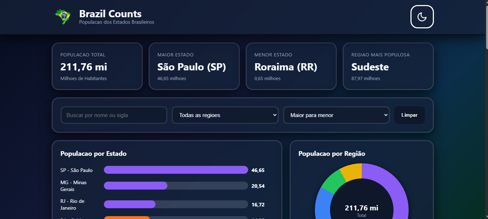

<h2 id="sobre-o-projeto">1. 📊 Brazil Counts: Inteligência de Dados:</h2>




> Bem-vindo ao `Brazil Counts!` Uma solução de Business Intelligence `Open Source` desenvolvida para visualizar a população dos estados brasileiros. O projeto visa resolver a dor de comparar população por estado e por região sem precisar abrir planilha, utilizando dados do `IBGE - Estimativas 2024.`

---

## 📚 Tabela de Conteúdo

| 📊 O Projeto | 🛠 Técnico | 🤝 Comunidade |
| :---: | :---: | :---: |
| [](#sobre-o-projeto) | [](#destaques-tecnicos) | [](#codigo-fonte) |
| [](#tecnologias-utilizadas) | [](#estrutura-do-projeto) | [](#créditos) |
| [](como-acessar) | [](#como-contribuir) | [](#licenca) |
| [](#insights-principais) | [](#faq) | [](#perfil-do-github) |

---

<h2 id="sobre-o-projeto">1. Brazil Counts: Inteligência de Dados 📊</h2>

No dia a dia, comparar população por estado e por região em planilha gera duas dores principais:
1. **Sem visão rápida:** Difícil ver de uma vez quem é o maior, quem é o menor e qual região concentra mais gente.
2. **Sem filtro:** Difícil isolar uma região ou buscar um estado sem refazer a tabela.

Este Dashboard atua como uma camada de inteligência sobre os dados do IBGE. Através do arquivo `estados.json`, o script em JavaScript calcula o total, o maior, o menor, a região mais populosa e cria um **gráfico de barras por estado**, um **gráfico de pizza por região** e uma **tabela completa** com o % do Brasil.

---

<h2 id="tecnologias-utilizadas">2. ⚙ Tecnologias Utilizadas</h2>

| Camada | Tecnologias | Descrição |
| :--- | :--- | :--- |
| **Linguagem** |  | Estrutura do dashboard, sem JS dentro. |
| **Estilo** |  | Glasmorphism, tema claro / escuro e responsivo. |
| **Lógica** |  | Filtros, KPIs, gráficos e tabela. |
| **Dados** |  | Lista dos 27 estados com nome, sigla, capital, região e população. |

---

<h2 id="como-acessar">3. 🚀 Como Acessar</h2>

Clique no botão abaixo para testar a interface do Finans em tempo real:

<div align="left">
  <a href="https://brazil-counts.web.app/" target="_blank">
    
  </a>
</div>

---

<h2 id="insights-principais">4. 🧩 Insights Principais</h2>

O projeto foca em simplicidade e feedback instantâneo para o usuário:

| Insight | Impacto |
| :--- | :--- |
| 📊 **População Total — 211,76 mi** | Visão imediata do tamanho do Brasil em milhões de habitantes. |
| 🏆 **Maior Estado — São Paulo (SP) — 46,65 mi** | Identificação do estado com maior população. |
| 📉 **Menor Estado — Roraima (RR) — 0,65 mi** | Identificação do estado com menor população. |
| 🗺 **Região Mais Populosa — Sudeste — 87,97 mi** | Visibilidade da região que concentra mais gente. |
| 🍕 **Pizza por Região** | Sudeste 41,5%, Nordeste 27,2%, Sul 14,4%, Norte 8,8%, Centro-Oeste 8,0%. |
| 📱 **Design Adaptável** | Interface limpa que permite a verificação em diferentes telas. |

---

<h2 id="destaques-tecnicos">5. 💻 Destaques Técnicos</h2>

O projeto foi construído com foco em **Reprodutibilidade** e **Clareza Analítica**:

<h3>🧹 Padrão Web Essentials:</h3>

HTML só com estrutura, CSS só com estilo e JS só com lógica. Identificadores em inglês, comentários e textos em pt-BR, indentação de 2 espaços. Sem framework, sem build, sem `npm`.

<h3>🔒 Sem Fallback — Nota de Confiabilidade:</h3>

Este projeto não usa dados embutidos como fallback. Se o `estados.json` não for encontrado, o `app.js` mostra o erro no console e na tela, sem fingir dados. Os caminhos tentados, nesta ordem, são:

```text
src/assets/data/estados.json
data/estados.json
/src/assets/data/estados.json
estados.json
```

<h3>🎨 Glasmorphism + Tema Claro / Escuro:</h3>

Cards com `backdrop-filter: blur(16px)`, borda de `2px` e `border-radius: 20px`. Header e footer em barra de ponta a ponta, sem pílula, com `--header` mais sólido que os cards para não sumir no fundo. Tema salvo em `localStorage` com a chave `tema`.

---

<h2 id="estrutura-do-projeto">6. 📂 Estrutura do Projeto</h2>

```text
Brazil-Counts-Web-Essentials
├── src/
│   └── assets/
│       ├── index.html          📌 Estrutura do dashboard.
│       ├── 404.html            📌 Página de erro com mesmo header e toggle.
│       ├── css/
│       │   └── style.css       📌 Estilo, Glasmorphism e responsivo.
│       ├── js/
│       │   └── app.js          📌 Lógica, filtros, KPIs, gráficos e tabela.
│       ├── data/
│       │   └── estados.json    📌 27 estados com nome, sigla, capital, região e população.
│       └── images/
│           └── logo.png        📌 Logo do Brazil Counts.
└── README.md                   📌 Documentação Técnica.
```

---

<h2 id="como-contribuir">7. 🤝 Como Contribuir</h2>

Deseja melhorar o design ou adicionar novas métricas? Siga o fluxo oficial:

| Fase | Ação | Link / Comando |
| :---: | :--- | :---: |
| **01** | **Fork** | [](https://github.com/Domisnnet/Brazil-Counts-Web-Essentials/fork) |
| **02** | **Branch** | `git checkout -b feature/NovoGrafico` |
| **03** | **Commit** | `git commit -m 'feat: add gráfico de pizza'` |
| **04** | **Push** | `git push origin feature/NovoGrafico` |
| **05** | **PR** | [](https://github.com/Domisnnet/Brazil-Counts-Web-Essentials/compare) |

<h3>🐛 Encontrou um problema?</h3>

Se algo não estiver funcionando como esperado, não hesite em abrir um chamado:

[](https://github.com/Domisnnet/Brazil-Counts-Web-Essentials/issues)
[](https://github.com/Domisnnet/Brazil-Counts-Web-Essentials/issues/new)

---

<h2 id="faq">8. 🧠 Perguntas Frequentes</h2>

<details>
<summary><strong>Os dados são reais ou fictícios ❓</strong></summary>
<p>
  📊 <strong>Resposta:</strong> Os dados utilizados são os do <code>IBGE - Estimativas 2024</code>, em <code>estados.json</code>, para fins de demonstração e estudo de técnicas de BI.
</p>
</details>

<details>
<summary><strong>Por que os KPIs ficam em -- ❓</strong></summary>
<p>
  ✅ <strong>Resposta:</strong> Porque o <code>estados.json</code> não foi encontrado em nenhum dos caminhos tentados. Abra o <code>F12</code> e veja o erro no console. Não abrir com <code>file://</code>, usar um servidor estático como <code>npx serve .</code>
</p>
</details>

<details>
<summary><strong>Como adicionar um novo gráfico ❓</strong></summary>
<p>
  🎨 <strong>Resposta:</strong> Crie um novo bloco no arquivo <code>src/assets/js/app.js</code>, crie uma função <code>renderizarNovoGrafico(lista)</code> e chame ela dentro de <code>atualizar()</code>. Adicione o estilo no <code>style.css</code> na seção correspondente.
</p>
</details>

---

<h2 id="codigo-fonte">9. 💻 Código Fonte</h2>

Deseja analisar a lógica de processamento? Explore o Repositório Oficial:

[](https://github.com/Domisnnet/Brazil-Counts-Web-Essentials)

---

<h2 id="créditos">10. 📝 Créditos & Reconhecimentos</h2>

O **Brazil Counts** é resultado de estudo contínuo em Web Essentials e BI:

| Atribuição | Responsável / Recurso | Descrição |
| :--- | :--- | :--- |
| **Análise de Dados** | **DomisDev** | Exploração, limpeza e visualização dos datasets. |
| **Empresa:** | | **Brazil Counts** | Contexto de negócio e origem dos dados. |
| **Engine Gráfica** | **CSS + conic-gradient** | Base para renderização da pizza por região. |
| **Manipulação** | **JavaScript puro** | Filtros, KPIs, barras, pizza e tabela. |
| **Apoio Técnico** | **Google Gemini** | Padronização e refinamento documental. |

---

<h2 id="licenca">11. 📄 Licença</h2>

Este projeto está licenciado sob a &nbsp;[](https://github.com/Domisnnet/Brazil-Counts-Web-Essentials/blob/main/LICENSE)

---

<h2 id="perfil-do-github">12. 👨💻 Perfil do GitHub</h2>

<a href="https://github.com/Domisnnet">
  
</a>

&nbsp;
<p align="center">
  <a href="#sobre-o-projeto">
    
  </a>
</p>
